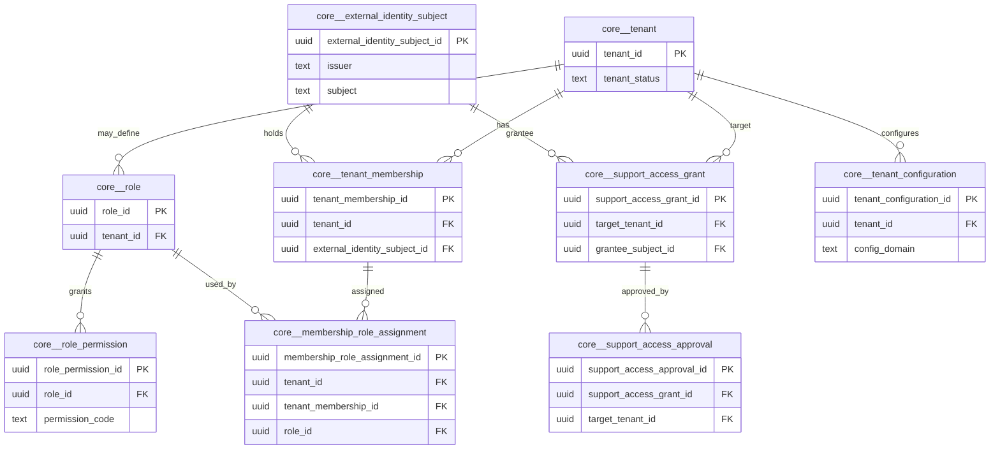

# CARES PostgreSQL Physical ERD (Round 2)

**Status:** Proposed physical ERD documentation only; **NOT IMPLEMENTED, NOT TESTED**. Mermaid diagrams are simplified physical-relationship views derived from the Round 1.1 logical baseline and Round 2 physical design. They do not replace the authoritative table/column/constraint specifications in [POSTGRESQL_PHYSICAL_SCHEMA_DESIGN.md](./POSTGRESQL_PHYSICAL_SCHEMA_DESIGN.md) or index/RLS/transaction/lifecycle documents.

**Validation note:** Mermaid source is provided as text and can be structurally reviewed; **visual rendering was not executed in this environment** (no renderer CLI verified). Structural Mermaid validation is reported as performed by source inspection only; visual rendering remains **NOT VERIFIED**.

## 1. Diagram conventions

- Physical identifiers are shown as `schema__table` labels in Mermaid entities for readability; actual proposed schema-qualified names are `schema.table`.
- `PK`, `FK`, and `UK` markers indicate key roles; not every column/constraint is shown.
- Tenant-owned tables carry `tenant_id` unless explicitly global/catalog-scoped.
- Tenant-consistent composite FK enforcement is a **design requirement** documented in the physical schema/RLS docs; single-column FK arrows in diagrams are simplified representations.
- Global/shared catalog tables are marked in notes.

## 2. ERD 1 — Core tenant, access, and configuration

**Notes:** `core.external_identity_subject` and system/global `core.role` records may be platform-scoped; tenant-defined roles and all memberships/grants/configurations are tenant-scoped or tenant-contextual as specified.

## 3. ERD 2 — Asset identity, lineage, and licensing

```mermaid
erDiagram
    core__tenant {
        uuid tenant_id PK
    }
    core__asset {
        uuid asset_id PK
        uuid tenant_id FK
        text asset_status
    }
    integration_ai__data_source {
        uuid data_source_id PK
        uuid tenant_id FK
    }
    core__asset_data_source {
        uuid asset_data_source_id PK
        uuid tenant_id FK
        uuid asset_id FK
        uuid data_source_id FK
        uuid source_device_key_id UK
    }
    core__source_device_key {
        uuid source_device_key_id PK
        uuid tenant_id FK
        uuid asset_data_source_id FK
    }
    core__source_device_fingerprint_alias {
        uuid source_device_fingerprint_alias_id PK
        uuid tenant_id FK
        uuid asset_data_source_id FK
        uuid source_device_key_id FK
    }
    core__asset_identity_claim {
        uuid asset_identity_claim_id PK
        uuid tenant_id FK
        uuid asset_id FK
        uuid data_source_id FK
    }
    core__identity_resolution_case {
        uuid identity_resolution_case_id PK
        uuid tenant_id FK
        uuid primary_asset_id FK
    }
    core__asset_lifecycle_event {
        uuid asset_lifecycle_event_id PK
        uuid tenant_id FK
        uuid asset_id FK
    }
    core__asset_merge_operation {
        uuid asset_merge_operation_id PK
        uuid tenant_id FK
        uuid surviving_asset_id FK
        uuid losing_asset_id FK
    }
    core__asset_split_operation {
        uuid asset_split_operation_id PK
        uuid tenant_id FK
        uuid source_asset_id FK
    }
    core__asset_lineage_link {
        uuid asset_lineage_link_id PK
        uuid tenant_id FK
        uuid from_asset_id FK
        uuid to_asset_id FK
        uuid merge_operation_id FK
        uuid split_operation_id FK
        text link_type
    }
    core__subscription_entitlement {
        uuid subscription_entitlement_id PK
        uuid tenant_id FK
    }
    core__tenant_license_usage_state {
        uuid tenant_license_usage_state_id PK
        uuid tenant_id FK
        uuid subscription_entitlement_id FK
    }
    core__asset_license_event {
        uuid asset_license_event_id PK
        uuid tenant_id FK
        uuid asset_id FK
    }
    core__identity_operation_idempotency_ledger {
        uuid identity_operation_idempotency_ledger_id PK
        uuid tenant_id FK
        text operation_type
        text idempotency_key
        text request_state
    }
    core__asset_license_reservation {
        uuid asset_license_reservation_id PK
        uuid tenant_id FK
        uuid asset_id FK
        uuid ledger_id FK
    }
    core__asset_tombstone {
        uuid asset_tombstone_id PK
        uuid tenant_id FK
        uuid asset_id FK
    }

    core__tenant ||--o{ core__asset : owns
    core__tenant ||--o{ integration_ai__data_source : configures
    core__asset ||--o{ core__asset_data_source : bound_by
    integration_ai__data_source ||--o{ core__asset_data_source : reports
    core__asset_data_source ||--o| core__source_device_key : dependent_projection
    core__asset_data_source ||--o{ core__source_device_fingerprint_alias : resolves_via
    core__asset ||--o{ core__asset_identity_claim : claimed
    core__identity_resolution_case ||--o{ core__asset_identity_claim : groups
    core__asset ||--o{ core__asset_lifecycle_event : history
    core__asset ||--o{ core__asset_merge_operation : survives_or_loses
    core__asset ||--o{ core__asset_split_operation : source
    core__asset ||--o{ core__asset_lineage_link : from_to
    core__asset_merge_operation ||--o{ core__asset_lineage_link : merge_ref
    core__asset_split_operation ||--o{ core__asset_lineage_link : split_ref
    core__tenant ||--o{ core__subscription_entitlement : entitled
    core__subscription_entitlement ||--o{ core__tenant_license_usage_state : governs
    core__asset ||--o{ core__asset_license_event : licensed
    core__tenant ||--o{ core__identity_operation_idempotency_ledger : scopes
    core__identity_operation_idempotency_ledger ||--o{ core__asset_license_reservation : correlates
    core__asset ||--o| core__asset_tombstone : terminal
```

**Notes:** `core.asset_data_source` is the proposed authoritative stable binding owning immutable `source_device_key_id` (OD-002 open). `core.source_device_key` is an optional 1:1 dependent projection only. `asset_lineage_link` enforces typed merge/split references (no polymorphic ref). Ledger and event receipt are distinct idempotency/dedup mechanisms.

## 4. ERD 3 — Ingest, processing, audit, and evidence

```mermaid
erDiagram
    core__tenant {
        uuid tenant_id PK
    }
    core__asset {
        uuid asset_id PK
        uuid tenant_id FK
    }
    integration_ai__data_source {
        uuid data_source_id PK
        uuid tenant_id FK
    }
    core__asset_data_source {
        uuid asset_data_source_id PK
        uuid source_device_key_id UK
    }
    ingest__event_schema_reference {
        uuid event_schema_reference_id PK
    }
    ingest__event_receipt {
        uuid event_receipt_id PK
        uuid tenant_id FK
        uuid data_source_id FK
        uuid source_device_key_id FK
        text event_namespace
        text upstream_event_identifier
    }
    ingest__security_event {
        uuid security_event_id PK
        uuid tenant_id FK
        uuid event_receipt_id FK
        uuid asset_id FK
    }
    processing__outbox_message {
        uuid outbox_message_id PK
        uuid tenant_id FK
        text message_status
    }
    processing__outbox_attempt {
        uuid outbox_attempt_id PK
        uuid outbox_message_id FK
        text attempt_status
    }
    processing__processing_work_item {
        uuid processing_work_item_id PK
        uuid tenant_id FK
        uuid event_receipt_id FK
        uuid outbox_message_id FK
    }
    audit_evidence__audit_event {
        uuid audit_event_id PK
        uuid tenant_id FK
    }
    audit_evidence__ai_interaction_audit {
        uuid ai_interaction_audit_id PK
        uuid tenant_id FK
        uuid audit_event_id FK
    }
    audit_evidence__forensic_evidence_record {
        uuid forensic_evidence_record_id PK
        uuid tenant_id FK
        uuid asset_id FK
    }
    audit_evidence__evidence_object_version {
        uuid evidence_object_version_id PK
        uuid forensic_evidence_record_id FK
        int version_number
    }
    audit_evidence__evidence_custody_event {
        uuid evidence_custody_event_id PK
        uuid forensic_evidence_record_id FK
    }
    audit_evidence__evidence_transition_authorization {
        uuid evidence_transition_authorization_id PK
        uuid forensic_evidence_record_id FK
    }

    ingest__event_schema_reference ||--o{ ingest__event_receipt : validates
    integration_ai__data_source ||--o{ ingest__event_receipt : receives_from
    core__asset_data_source ||--o{ ingest__event_receipt : binding_context
    core__asset ||--o{ ingest__event_receipt : attributed
    ingest__event_receipt ||--o| ingest__security_event : normalized
    processing__outbox_message ||--o{ processing__outbox_attempt : attempted
    ingest__event_receipt ||--o{ processing__processing_work_item : optional_work
    processing__outbox_message ||--o{ processing__processing_work_item : optional_work
    audit_evidence__audit_event ||--o{ audit_evidence__ai_interaction_audit : correlates
    core__asset ||--o{ audit_evidence__forensic_evidence_record : subject
    audit_evidence__forensic_evidence_record ||--o{ audit_evidence__evidence_object_version : versions
    audit_evidence__forensic_evidence_record ||--o{ audit_evidence__evidence_custody_event : custody
    audit_evidence__forensic_evidence_record ||--o{ audit_evidence__evidence_transition_authorization : controls
```

**Notes:** `event_receipt` dedup uniqueness is namespace-specific (explicit device-scoped/data-source-global/fallback basis per OD-013). Outbox delivery is at-least-once with unknown-outcome handling; no exactly-once external delivery. `processing_work_item` is optional/non-core and must not replace receipt/outbox truth.

## 5. ERD 4 — Integration/AI and SOC

```mermaid
erDiagram
    core__tenant {
        uuid tenant_id PK
    }
    core__asset {
        uuid asset_id PK
        uuid tenant_id FK
    }
    integration_ai__integration_configuration {
        uuid integration_configuration_id PK
        uuid tenant_id FK
    }
    integration_ai__data_source {
        uuid data_source_id PK
        uuid tenant_id FK
        uuid integration_configuration_id FK
    }
    integration_ai__tenant_ai_provider_configuration {
        uuid tenant_ai_provider_configuration_id PK
        uuid tenant_id FK
    }
    integration_ai__ai_provider_secret_reference {
        uuid ai_provider_secret_reference_id PK
        uuid tenant_id FK
        uuid provider_configuration_id FK
    }
    integration_ai__ai_provider_policy_consent_reference {
        uuid ai_provider_policy_consent_reference_id PK
        uuid tenant_id FK
        uuid provider_configuration_id FK
    }
    integration_ai__ai_usage_budget_accounting {
        uuid ai_usage_budget_accounting_id PK
        uuid tenant_id FK
        uuid provider_configuration_id FK
    }
    audit_evidence__ai_interaction_audit {
        uuid ai_interaction_audit_id PK
        uuid tenant_id FK
        uuid provider_configuration_id FK
    }
    ingest__security_event {
        uuid security_event_id PK
        uuid tenant_id FK
    }
    soc__detection_rule {
        uuid detection_rule_id PK
        uuid tenant_id FK
    }
    soc__detection_rule_version {
        uuid detection_rule_version_id PK
        uuid detection_rule_id FK
    }
    soc__incident_case {
        uuid incident_case_id PK
        uuid tenant_id FK
    }
    soc__alert {
        uuid alert_id PK
        uuid tenant_id FK
        uuid asset_id FK
        uuid security_event_id FK
        uuid incident_case_id FK
        uuid detection_rule_version_id FK
    }
    soc__asset_inventory_observation {
        uuid asset_inventory_observation_id PK
        uuid tenant_id FK
        uuid asset_id FK
        uuid data_source_id FK
    }
    soc__vulnerability_finding {
        uuid vulnerability_finding_id PK
        uuid tenant_id FK
        uuid asset_id FK
        uuid asset_inventory_observation_id FK
    }
    soc__threat_intelligence_reference {
        uuid threat_intelligence_reference_id PK
        text source_name
        text external_reference
    }

    core__tenant ||--o{ integration_ai__integration_configuration : configures
    integration_ai__integration_configuration ||--o{ integration_ai__data_source : parameterizes
    core__tenant ||--o{ integration_ai__tenant_ai_provider_configuration : selects_provider
    integration_ai__tenant_ai_provider_configuration ||--o{ integration_ai__ai_provider_secret_reference : secret_ref
    integration_ai__tenant_ai_provider_configuration ||--o{ integration_ai__ai_provider_policy_consent_reference : governed_by
    integration_ai__tenant_ai_provider_configuration ||--o{ integration_ai__ai_usage_budget_accounting : accounted
    integration_ai__tenant_ai_provider_configuration ||--o{ audit_evidence__ai_interaction_audit : audited
    soc__detection_rule ||--o{ soc__detection_rule_version : versioned
    soc__detection_rule_version ||--o{ soc__alert : triggers
    ingest__security_event ||--o{ soc__alert : source
    core__asset ||--o{ soc__alert : affects
    soc__incident_case ||--o{ soc__alert : groups
    core__asset ||--o{ soc__asset_inventory_observation : observed
    integration_ai__data_source ||--o{ soc__asset_inventory_observation : reported_by
    core__asset ||--o{ soc__vulnerability_finding : affects
    soc__asset_inventory_observation ||--o{ soc__vulnerability_finding : evidenced_by
```

**Notes:** `soc.threat_intelligence_reference` is proposed global/shared; tenant use must not leak tenant data across boundaries. AI provider configuration is explicit per tenant (no silent failover/automatic transfer); secrets are external references only. Detection rules may be tenant-owned or explicitly managed global-scope by policy (Proposed).

## 6. Traceability and omissions

- All logical entities mapped in the physical schema design are represented in at least one ERD or explicitly covered by domain notes above (including `asset_license_event`, `evidence_object_version`, `evidence_custody_event`, `evidence_transition_authorization`, `membership_role_assignment`, `role_permission`, `support_access_approval`, `source_device_fingerprint_alias`, `asset_identity_claim`, `identity_resolution_case`, `asset_tombstone`, `ai_usage_budget_accounting`, `processing_work_item`).
- Relationship cardinalities and optionality shown are simplified; authoritative nullability/FK/uniqueness rules are defined in [POSTGRESQL_PHYSICAL_SCHEMA_DESIGN.md](./POSTGRESQL_PHYSICAL_SCHEMA_DESIGN.md).
