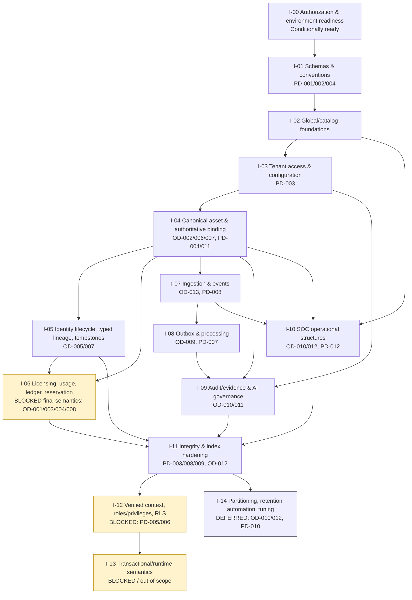
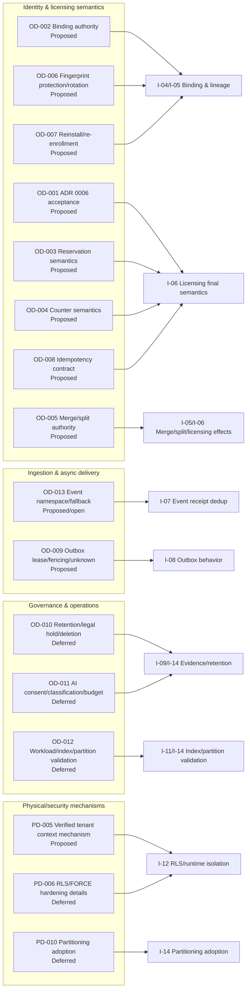

# CARES PostgreSQL Round 3 Dependency Map

**Status:** Proposed planning artifact only; **NOT IMPLEMENTED, NOT TESTED, NOT APPROVED FOR EXECUTION**. This map visualizes implementation sequencing, component dependencies, and approval/validation gates derived from Round 2 baselines and recorded open decisions. It does not change OD/PD/ADR statuses or authorize execution.

**Related documents:** [POSTGRESQL_ROUND3_IMPLEMENTATION_PLAN.md](./POSTGRESQL_ROUND3_IMPLEMENTATION_PLAN.md), [POSTGRESQL_ROUND3_IMPLEMENTATION_WORK_BREAKDOWN.md](./POSTGRESQL_ROUND3_IMPLEMENTATION_WORK_BREAKDOWN.md), [POSTGRESQL_ROUND3_MIGRATION_AND_DEPLOYMENT_STRATEGY.md](./POSTGRESQL_ROUND3_MIGRATION_AND_DEPLOYMENT_STRATEGY.md), [POSTGRESQL_ROUND3_TEST_AND_ACCEPTANCE_PLAN.md](./POSTGRESQL_ROUND3_TEST_AND_ACCEPTANCE_PLAN.md), [POSTGRESQL_ROUND3_READINESS_AND_BLOCKER_MATRIX.md](./POSTGRESQL_ROUND3_READINESS_AND_BLOCKER_MATRIX.md), [POSTGRESQL_ROUND3_CHANGELOG.md](./POSTGRESQL_ROUND3_CHANGELOG.md), [POSTGRESQL_ROUND3_FINAL_REVIEW.md](./POSTGRESQL_ROUND3_FINAL_REVIEW.md).

## 1. Phase and increment dependency flow

## 2. Decision and approval gate map

## 3. Domain-to-operation dependency view

| Round 2 operation | Primary tables/domains (planned dependency groups) | Key prerequisites / gates |
|---|---|---|
| Op 1 New canonical asset registration | ledger, asset, asset_data_source, optional source_device_key, alias/claim/lifecycle, usage/entitlement/license/reservation, audit | I-04–I-06, I-09; OD-001/002/003/004/008; verified context/RLS for runtime |
| Op 2 Existing asset attachment | ledger, asset, asset_data_source, alias/claim/lifecycle, audit | I-04–I-06; OD-002/008; no duplicate licensed usage invariant |
| Op 3 Fingerprint alias creation | alias, authoritative binding, claim/lifecycle, audit | I-04; OD-006; PD-011 representation decisions |
| Op 4 Fingerprint rotation | alias, binding, lifecycle, audit | I-04; OD-006/007; immutable `source_device_key_id` |
| Op 5 Identity conflict/pending resolution | resolution case, claim, asset/binding reads, lifecycle, audit | I-04/I-05; OD-007; no auto-billing/incorrect binding |
| Op 6 Asset merge | merge op, assets, typed lineage, tombstone, binding/alias/claim reassignment, usage/license events, ledger, audit | I-04–I-06, I-09; OD-005/003/004/008; typed lineage integrity |
| Op 7 Asset split | split op, assets, typed lineage, tombstone as applicable, reassignment, usage/license events, ledger, audit | I-04–I-06, I-09; OD-005/003/004/008; capacity/evidence rules |
| Op 8 Deactivation/reactivation/removal | asset, lifecycle/license events, usage state, tombstone, binding status, ledger, audit | I-04–I-06; OD-003/004/008 |
| Op 9 Quota allocation/reservation/release | usage state, entitlement, reservation, license event, ledger, audit | I-06; OD-001/003/004/008; contention-safe locking design |
| Op 10 Event ingestion acceptance | event_receipt, security_event, schema refs, data source/binding/asset attribution, optional outbox/work item, audit | I-04, I-07, I-08; OD-013/PD-008; namespace-scoped dedup |
| Op 11 Outbox claim and processing | outbox_message, outbox_attempt, optional work item, audit | I-08; OD-009/PD-007; claim/lease validation |
| Op 12 Outbox external delivery unknown outcome | outbox_attempt, outbox_message, audit | I-08; OD-009; unknown != success, no exactly-once |
| Op 13 Forensic evidence creation/transition | forensic evidence record/version/custody/authorization, audit | I-09; OD-010; controlled transitions and legal-hold constraints |

## 4. Traceability matrix (planning level)

| Traceability dimension | Source baseline | Round 3 planning artifact(s) |
|---|---|---|
| Logical entities and Round 1.1 corrections | Logical model, ERD, transaction boundaries, OD register, Round 1.1 audit | All Round 3 docs; especially plan/WBS/matrix |
| Physical tables (50), schemas, constraints, indexes | Physical schema design, ERD, index strategy | Plan, WBS, migration strategy, test plan, dependency map |
| Transaction boundaries (Ops 1–13) | Physical transaction design | Plan, WBS, migration strategy, test plan, dependency map, final review |
| Tenant isolation and RLS posture | RLS/tenant isolation design, security architecture, threat model | Plan, WBS, migration strategy, test plan, readiness matrix, final review |
| Lifecycle/retention/maintenance | Data lifecycle and retention design | Plan, migration strategy, test plan, readiness matrix, dependency map |
| Open decisions and physical decisions | OD register, physical open decisions, Round 2 final review | Readiness matrix, dependency map, changelog, final review |
| ADR/roadmap/project constraints | ADR 0001–0006, roadmap, project status, requirements traceability | Plan, changelog, final review (no status changes) |
